# Tasks

**A calm desktop workspace for small studios and freelancers — tasks, clients and money in one window.**

Free · macOS & Windows · English / Українська / Русский

[**⬇ Download**](https://github.com/1312dev/Tasks/releases/latest) · [What's inside](#whats-inside) · [Install](#install) · [Українською](#українською)

 

 

## Why Tasks

Most task managers want an account, a subscription and your data in somebody else's cloud.
Tasks doesn't. It's a desktop app that keeps the whole studio in one window — what needs doing,
who does it, for which client, and whether the money has arrived. Your data stays on your
computer, or on your own server if you want several devices. No sign-up, no ads, no fees.

## What's inside

**Work**
- **Tasks with checklists** — project, company, assignee, priority, deadline and amount.
  One click moves a task forward; a task can't be closed until every checklist step is done.
- **My projects: people and projects** — people cards with a photo, role, contacts, Telegram and their projects;
  projects with an avatar, colour, client company, team and their own Telegram chat.
- **Companies and contacts** — a logo, contact details and representatives; every representative is a contact too.
  Each company shows its tasks, progress and what it still owes.
- **Archive** — finished work, searchable by period, project and payment.

**Money**
- **Payments in one click** — Unpaid → Paid → No payment. Income is counted on the day the money arrives.
- **Expenses by category** and **budget top-ups** from any source, with income categories you control.
- **One balance across currencies** — a main currency plus up to three extra ones, chosen from
  16 currencies popular in Europe. Rates come from the ECB and the National Bank of Ukraine and refresh daily.

**Overview**
- **Home** — open and overdue tasks, this month's income and expenses, what's up next, a six-month budget chart.
- **Reports** for any period — by project and by company, saved as TXT or sent to Telegram.
- **Telegram for the whole team** — several chats, and private messages to people: a new task goes straight
  to the assignee and to the project chat. Today's tasks every morning (to the team and to each person),
  weekly and monthly reports — from your computer or from your own server.

**Yours**
- **Data on your computer** — automatic daily backups, export and import in one file.
- **Your own server (optional)** — a single Node.js file. Data is encrypted with your key (AES-256-GCM)
  before it leaves the app, and stays in sync between Macs and Windows PCs.
- **Dark, light or system theme**, nine accent colours, three languages.
- **Updates from GitHub** — a new release shows up right on the Home screen with an *Update* button.

## Install

Download the latest version from **[Releases](https://github.com/1312dev/Tasks/releases/latest)**.

| System | File |
|---|---|
| macOS 13+ (Apple Silicon & Intel) | `Tasks-x.x.x-mac.dmg` |
| Windows 10 / 11 (64-bit) | `Tasks-x.x.x-windows-setup.exe` |

The builds are free and not code-signed, so the system asks once on first launch:

- **macOS** — open the `.dmg` and drag Tasks into *Applications*. On first launch macOS says it can't verify
  the app: click *Done*, then *System Settings → Privacy & Security → Open Anyway*.
  If there's no such button, run in Terminal: `xattr -dr com.apple.quarantine /Applications/Tasks.app`
- **Windows** — run the installer. If *Windows protected your PC* appears: *More info → Run anyway*.

Updating: install the new version over the old one — data and settings stay. From 2.0 on, Tasks offers
the update itself.

A step-by-step user guide in English, Ukrainian and Russian comes with the app:
*Settings → Info → Open guide*.

## Privacy

Tasks has no accounts and no analytics. It goes online only to fetch exchange rates (ECB and NBU),
check GitHub for updates, send to Telegram (if you turn it on) and talk to your own server (if you set one up).

## Developer

Designed and developed by **1312 Wrap Design** — questions, ideas and bug reports are welcome.

[Telegram](https://t.me/wrap1312design) · [Instagram](https://www.instagram.com/1312.wrap.design/) ·
[Behance](https://www.behance.net/wrapdesign1) · [YouTube](https://www.youtube.com/@1312wrapdesign) ·
[GitHub](https://github.com/1312dev) · [Website](https://1312dev.github.io/)

 

---

 

## Українською

**Спокійний робочий простір для невеликих студій і фрилансерів — завдання, клієнти й гроші в одному вікні.**
Безкоштовно · macOS і Windows · English / Українська / Русский

[**⬇ Завантажити**](https://github.com/1312dev/Tasks/releases/latest)

### Навіщо Tasks

Більшість менеджерів завдань хочуть акаунт, підписку й ваші дані в чужій хмарі. Tasks — ні.
Це програма для компʼютера, у якій уся студія в одному вікні: що треба зробити, хто робить,
для якого клієнта і чи прийшли вже гроші. Дані зберігаються на вашому компʼютері або на вашому
власному сервері, якщо пристроїв кілька. Без реєстрації, реклами й оплати.

### Що всередині

**Робота**
- **Завдання з чеклістами** — проєкт, компанія, виконавець, пріоритет, дедлайн і сума.
  Один клік рухає завдання далі, а закрити його можна лише після всіх пунктів чекліста.
- **Мої проєкти: персонал і проєкти** — картки співробітників із фото, роллю, контактами, Telegram і їхніми проєктами;
  проєкти з аватаром, кольором, компанією-клієнтом, командою й власним чатом у Telegram.
- **Компанії та контакти** — логотип, дані для звʼязку й представники; кожен представник — це й контакт.
  У кожної компанії її завдання, прогрес і скільки вона ще винна.
- **Архів** — виконана робота з пошуком за періодом, проєктом і оплатою.

**Гроші**
- **Оплата в один клік** — Не оплачено → Оплачено → Без оплати. Дохід рахується в день, коли надійшли гроші.
- **Витрати за категоріями** і **поповнення бюджету** з будь-яких джерел, з категоріями доходу, які ви налаштовуєте самі.
- **Один баланс у кількох валютах** — основна валюта й до трьох додаткових із 16 популярних у Європі.
  Курси ЄЦБ і Національного банку України, оновлюються щодня.

**Огляд**
- **Головна** — завдання в роботі й прострочені, дохід і витрати за місяць, найближчі завдання, графік бюджету за пів року.
- **Звіти** за будь-який період — за проєктами й компаніями, у TXT або одразу в Telegram.
- **Telegram для всієї команди** — кілька чатів і особисті повідомлення: нове завдання одразу приходить
  виконавцю й у чат проєкту. Завдання на сьогодні щоранку (команді й кожному особисто), звіти за тиждень
  і місяць — з вашого компʼютера або з власного сервера.

**Ваше**
- **Дані на вашому компʼютері** — щоденні резервні копії, експорт та імпорт одним файлом.
- **Власний сервер (за бажанням)** — один файл на Node.js. Дані шифруються вашим ключем (AES-256-GCM)
  ще до того, як залишать програму, і синхронізуються між Mac і Windows.
- **Темна, світла або системна тема**, девʼять кольорів акценту, три мови.
- **Оновлення з GitHub** — новий реліз зʼявляється просто на головній із кнопкою «Оновити».

### Встановлення

Завантажте останню версію в **[Releases](https://github.com/1312dev/Tasks/releases/latest)**:
`Tasks-x.x.x-mac.dmg` для macOS 13+ (Apple Silicon та Intel) або `Tasks-x.x.x-windows-setup.exe`
для Windows 10 / 11 (64-bit).

Збірки безкоштовні й без платного підпису, тому під час першого запуску система перепитає:

- **macOS** — відкрийте `.dmg` і перетягніть Tasks у «Програми». Під час першого запуску натисніть «Готово»,
  потім «Системні параметри → Приватність і безпека → Усе одно відкрити». Якщо кнопки немає —
  у Терміналі: `xattr -dr com.apple.quarantine /Applications/Tasks.app`
- **Windows** — запустіть інсталятор. Якщо зʼявиться «Windows захистила ваш компʼютер» —
  «Докладніше → Усе одно запустити».

Оновлення: встановіть нову версію поверх старої — дані й налаштування збережуться.
Починаючи з 2.0, Tasks сам пропонує оновлення.

Покроковий посібник англійською, українською та російською — у програмі:
«Налаштування → Інформація → Відкрити посібник».

### Приватність

У Tasks немає акаунтів і аналітики. В інтернет програма звертається лише по курси валют (ЄЦБ і НБУ),
перевірку оновлень на GitHub, надсилання в Telegram (якщо ввімкнено) та обмін із вашим сервером (якщо налаштовано).

### Розробник

Дизайн і розробка — **1312 Wrap Design**. Пишіть з питаннями, ідеями й знайденими помилками.

[Telegram](https://t.me/wrap1312design) · [Instagram](https://www.instagram.com/1312.wrap.design/) ·
[Behance](https://www.behance.net/wrapdesign1) · [YouTube](https://www.youtube.com/@1312wrapdesign) ·
[GitHub](https://github.com/1312dev) · [Website](https://1312dev.github.io/)

 

© 2026 1312 Wrap Design · Tasks is free to use

