## What's new in 2.2.1

**You choose where a task is announced**
- A new *Telegram* line under the task form (and in task editing): *Private and chat*, *Only the assignee* or *Only the chat*.
- *The chat* is the project's chat, or the main chat if the project has none. A chat message carries the assignee's name.
- Handing a task over to someone else follows the same choice.
- Tasks created before 2.2.1 keep working as before: privately and to the chat.

**Every message says where it comes from**
- Every message from the bot — new tasks, today's tasks, weekly and monthly reports, reports from the Report panel and test messages — now starts with **Tasks · your workspace name**.
- Handy when one bot serves several apps or workspaces, and when messages go to private chats that only you and the bot are in.

User guides (EN / UK / RU) updated.

### Downloads
- **macOS 13+** (Apple Silicon & Intel): `Tasks-2.2.1-mac.dmg`
- **Windows 10 / 11** (64-bit): `Tasks-2.2.1-windows-setup.exe`

Install over 2.2 — your data and settings stay. The builds are not code-signed:
on macOS use *System Settings → Privacy & Security → Open Anyway*, on Windows *More info → Run anyway*.

---

## Що нового у 2.2.1

**Ви обираєте, куди повідомити про завдання**
- Новий рядок «Telegram» під формою завдання (і в редагуванні): «Особисто й у чат», «Лише особисто виконавцю» або «Лише в чат».
- «Чат» — це чат проєкту, а якщо його немає — загальний чат. У чат повідомлення приходить з імʼям виконавця.
- Передача завдання іншій людині працює за тим самим вибором.
- Завдання, створені до 2.2.1, працюють як раніше: особисто й у чат.

**Кожне повідомлення підписане**
- Кожне повідомлення бота — нові завдання, завдання на сьогодні, звіти за тиждень і місяць, звіти з панелі «Звіт» і тестові — тепер починається з **Tasks · назва вашого кабінету**.
- Зручно, коли один бот працює з кількома програмами чи кабінетами, а повідомлення йдуть у закриті чати, де лише ви й бот.

Оновлено посібники (EN / UK / RU).

### Завантаження
- **macOS 13+** (Apple Silicon та Intel): `Tasks-2.2.1-mac.dmg`
- **Windows 10 / 11** (64-bit): `Tasks-2.2.1-windows-setup.exe`

Встановлюйте поверх 2.2 — дані й налаштування збережуться. Збірки без платного підпису:
на macOS — «Системні параметри → Приватність і безпека → Усе одно відкрити», на Windows — «Докладніше → Усе одно запустити».
